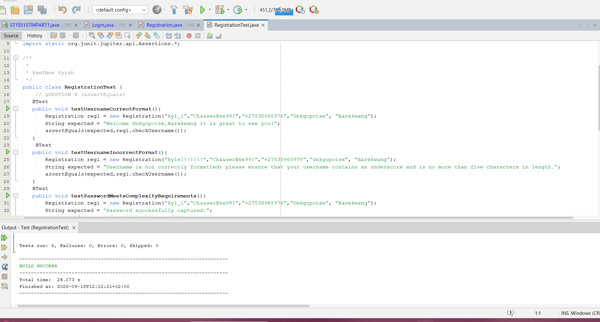

# # PROG5121‑PART1

## Project Overview
This repository contains the source code and JUnit tests for **Question 4,8 & 9** of the PROG5121 POE.  
The project demonstrates how to validate user registration and login details using Java and JUnit in NetBeans.
In Part 2 This project is a **simple messaging system** developed in Java as part of a POE assignment. It validates messages, generates unique IDs and hashes, processes user options (send, discard, store), and saves valid messages into a JSON file. The system demonstrates object‑oriented programming, input validation, control flow, string manipulation, and file handling.
Part 3 extends the QuickChat messaging system by introducing message management functionality using ArrayLists. Messages are categorized as Sent, Stored, or Disregarded, allowing users to search, analyse, delete, and generate reports based on message data.

---

## Features
- **Main.java**
  - Entry point of the program.
  - Demonstrates how Registration and Login classes work together.
  - Accepts user input, runs validations, and displays results.
  - Shows login success or failure based on credentials.

- **Registration.java**
  - Validates username, password, and cell phone number.
  - Returns clear messages for correctly and incorrectly formatted inputs.
  - Displays a personalized welcome message when the username is valid.

- **Login.java**
  - Verifies login credentials using Boolean checks.
  - Confirms whether username, password, and cell number meet formatting rules.
  - Returns `true` or `false` for login success or failure.

- **JUnit Tests**
  - `RegistrationTest.java` uses `assertEquals()` to compare expected and actual messages.
  - `LoginTest.java` uses `assertTrue()` and `assertFalse()` to verify Boolean results.
  - Test data matches the POE Question 4 table exactly.
 
-**PART 2**
## Features 
- Validate recipient numbers (`+27` format) and message length (≤250 characters).
- Generate unique 10‑digit Message IDs.
- Create message hashes based on message content.
- Process user options: **Send**, **Disregard**, or **Store**.
- Persist messages in a JSON file (`messages.json`).
- Return rubric‑aligned outputs for JUnit testing.
- 
##  Requirements
- Java 8 or higher  
- JUnit 5 for testing  
- `org.json.simple` library for JSON storage  
---
-**PART 3**
## Features
## MessageManager.java
Manages all message collections.
Stores:
## Sent Messages
Stored Messages
Disregarded Messages
Message IDs
Message Hashes
## Message Categorisation
Messages are automatically grouped according to the user's selected action:

Send Message
Store Message
Disregard Message
## Search Functionality
The system allows users to:

Search for a message using a Message ID.
Search for messages belonging to a specific recipient.
Message Analysis
The system can:

Display all stored messages.
Display the longest stored message.
## Delete Functionality
Messages can be removed using their unique message hash.

## Reporting
The application generates a report containing:

Message ID
Message Hash
Recipient Number
Message Content

## New Files Added

### MessageManager.java
Responsible for:
- Managing ArrayLists
- Searching messages
- Deleting messages
- Generating reports
- Loading test data

### MessageManagerTest.java
JUnit test class used to verify:
- Collection population
- Search functionality
- Message deletion
- Longest stored message retrieval
- Report generation

## Part 3 Test Data

| Message | Recipient | Message Content | Status |
|----------|------------|----------------|---------|
| 1 | +27834557896 | Did you get the cake? | Sent |
| 2 | +27838884567 | Where are you? You are late! I have asked you to be on time. | Stored |
| 3 | +27834484567 | Yohoooo, I am at your gate. | Disregarded |
| 4 | 0838884567 | It is dinner time! | Sent |
| 5 | +27838884567 | Ok, I am leaving without you. | Stored |

## Part 3 JUnit Tests

The following functionality is tested using JUnit:

- Sent messages correctly populated.
- Stored messages correctly populated.
- Disregarded messages correctly populated.
- Message ID collection population.
- Message hash collection population.
- Search by Message ID.
- Search by recipient.
- Longest stored message identification.
- Delete message using hash.
- Report generation.

## Learning Outcomes Demonstrated

- Object-Oriented Programming (OOP)
- ArrayList Collections
- Searching Algorithms
- Report Generation
- Data Categorisation
- JSON File Handling
- JUnit 5 Testing
- Encapsulation and Class Design

## Updated Project Structure

```text
src/
│
├── Registration.java
├── Login.java
├── Message.java
├── MessageManager.java
├── ST10515704PART1.java
│
└── TestClasses
    ├── RegistrationTest.java
    ├── LoginTest.java
    ├── MessageTest.java
    └── MessageManagerTest.java

## Test Data Summary
| Test Case | Input | Expected Output |
|------------|--------|----------------|
| Username correctly formatted | `kyl_1` | `Welcome Onkgopotse, Barekwang it is great to see you.` |
| Username incorrectly formatted | `kyle!!!!!!!` | `Username is not correctly formatted; please ensure that your username contains an underscore and is no more than five characters in length.` |
| Password meets complexity | `Ch&&sec@ke99!` | `Password successfully captured.` |
| Password fails complexity | `password` | `Password is not correctly formatted; please ensure that the password contains at least eight characters, a capital letter, a number, and a special character.` |
| Cell number correctly formatted | `+27838968976` | `Cell number successfully captured.` |
| Cell number incorrectly formatted | `08966553` | `Cell number is incorrectly formatted or does not contain an international code; please correct the number and try again.` |

---

## How to Run Tests
1. Open the project in **Apache NetBeans IDE 30**.  
2. Right‑click each test class (`RegistrationTest.java` and `LoginTest.java` and 'MessageTest.java).  
3. Select **Run File** to execute the tests.  
4. A **green bar** indicates all tests passed successfully.

---

## User Desktop Screenshot Image
**The following screenshot shows the workspace setup used while completing Question 4.** 

 


## Author
**Onkgopotse Barekwang**  
Student at **IIE Rosebank College**  
Module: **PROG5121 – Programming

---

## Notes
- All test data and expected outputs follow the official POE Question 4 marking guide.  
- The project demonstrates proper use of constructors, conditional logic, and JUnit testing best practices.
official POE marking guide.  
- Demonstrates understanding of constructors, conditional logic, and automated testing.

## REFRENCES 
## 📚 References
- Cengage Learning. (2021). *Java Programming: Comprehensive Concepts and Applications* (10th ed.). MindTap Course List. ISBN: 9780357673423.
https://www.w3schools.com/java/java_encapsulation.asp
https://www.geeksforgeeks.org/java/regular-expressions-in-java/

